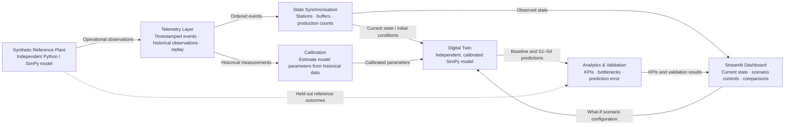

# Digital Twin of a Three-Station Production Line — Project Charter

## 1. Problem & Research Question

**Problem:** Production bottlenecks emerge from interactions among processing stations, finite buffers, variable cycle times, and downtime.

**Research question:** How can a digital twin identify bottlenecks and quantify the effects of alternative operating configurations on production-line performance?

## 2. Objectives & KPIs

- **O1 — State representation:** synchronise station and buffer states with emulated telemetry.
- **O2 — Bottleneck detection:** identify production constraints using operational metrics.
- **O3 — Scenario evaluation:** compare baseline and alternative configurations.
- **O4 — Model credibility:** verify behaviour and quantify prediction error.

**Primary KPIs:** throughput (units/h), station utilisation (%), average queue waiting time (s), average work-in-progress (items).

**Diagnostic KPIs:** blocking time (%), starvation time (%), downtime (%), simulation execution time (s).

## 3. System Scope & Boundaries

- **Included:** sequential stations A → B → C; two finite buffers; item arrivals; stochastic cycle times; processing/idle/blocked/starved/failed states; failures and repairs; output counts.
- **Excluded:** machine mechanics, energy use, workforce, quality inspection, upstream supply chain, factory-wide scheduling, predictive maintenance.
- **Modelling approach:** stochastic discrete-event simulation (DES); event-driven state updates.
- **PoC:** Python/SimPy simulation, telemetry replay, state synchronisation, Streamlit visualisation and scenario controls.

## 4. Experimental Strategy

| ID | Scenario | Changed variable |
|---|---|---|
| S0 | Baseline | Nominal configuration |
| S1 | Cycle-time improvement | Station B processing time |
| S2 | Buffer expansion | Buffer 1 capacity |
| S3 | Increased load | Item arrival rate |
| S4 | Downtime | Station B failures/repair |

**Method:** one-factor-at-a-time experiments; parameter sweeps; stochastic replications; reproducible random seeds; baseline-relative KPI changes and confidence intervals. Compare equivalent simulated operating periods and initial conditions.

## 5. Data & Validation Strategy

- **Primary — synthetic reference plant:** independently specified Python/SimPy event generator; configurable station cycle-time distributions, arrivals, failures/repairs, and finite buffers. Outputs: timestamped event logs, historical cycle records, queue observations, and replayable telemetry. [SimPy documentation](https://simpy.readthedocs.io/en/stable/).
- **Secondary — real industrial dataset:** [Industrial Production Time-Series Dataset from a Beverage Bottling Line (Zenodo, DOI: 10.5281/zenodo.18146866)](https://doi.org/10.5281/zenodo.18146866). IIoT-collected hourly/daily production, operational time and downtime events (2022–2023); CC BY 4.0. *Compatible aggregate KPI plausibility checks only*, not three-station model validation.
- **Calibration:** training observations; **validation:** held-out observations and scenario responses.
- **Verification:** state-transition and conservation invariants, buffer limits, reproducibility tests.
- **Quantitative assessment:** throughput/WIP/wait-time errors; bottleneck agreement; scenario effect direction and magnitude; 95% confidence intervals.
- **Credibility limit:** synthetic validation establishes performance against hypothetical reference behaviour, **not** real-factory accuracy.

## 6. Expected Deliverables & Success Criteria

**Deliverables:** concise technical report; working interactive PoC; system/data-flow architecture; documented telemetry or scenario exchange contract; baseline-versus-scenario plots; validation results; proposed production architecture and technology rationale; final presentation.

**Acceptance criteria:**
- Current station/buffer states update from replayed telemetry.
- S0–S4 execute and produce comparable primary and diagnostic KPIs.
- Automated invariants pass; errors and statistical uncertainty are reported.
- At least one exchange contract specifies payload, format, frequency, errors, and versioning.
- Model limitations and gaps between PoC and production deployment are explicit.

## 7. Constraints, Assumptions & Risks

- **Constraints:** bounded three-station system; lightweight PoC; no physical PLC/plant connection required.
- **Assumptions:** single product flow, sequential routing, finite buffers, stationary scenario settings within each run; parameters/distributions to be specified during modelling.
- **Risks:** circular synthetic validation; unrealistic assumptions; scarce comparable real datasets; stochastic variance; implementation scope creep.
- **Mitigations:** independent reference model, held-out data, explicit provenance, sensitivity checks, reproducible tests, strict separation of PoC and production design.

## System flow

Components:

- Reference plant (SimPy): Simulates the hypothetical physical factory.
- Telemetry system: Collects, stores and replays the reference plant's operational data.
- State synchronizer: Maintains an up-to-date digital representation of the production line using telemetry.
- Calibration: Estimates the digital twin's parameters from historical observations.
- Twin simulation model: A separate simulation model that uses calibrated parameters to reproduce production behaviour and predict what happens when configurations change.
- Analytics: Calculates throughput, machine utilisation, waiting time, WIP and bottleneck indicators.
- Dashboard: Interactive monitoring and decision-support interface.

