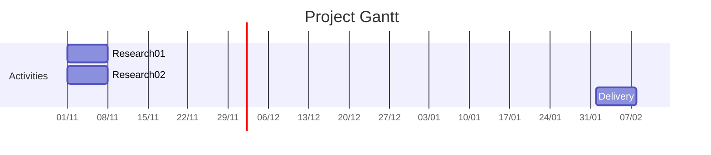

# Gantt diagramm

## List of activites

### Research

- define project scope and objectives;
- identify available real datasets;
- research existing components;
- define KPIs;

### Design

- define the three-station production line;
- define the overall PoC architecture;
- define simulation scenarios;

### Sprint 1

- implement the synthetic reference plant in SimPy;
- implement the digital twin with nominal configuration;
- implement telemetry generation and replay;
- verify simulation behaviour;
