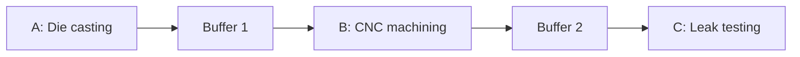

# Three-Station Production Line

**Use case:** Hypothetical aluminium production cell.

## Model

- **Items:** One product type; one item per cycle; sequential A → B → C; all items pass testing.
- **Stations:** Stochastic cycle times; idle, processing, blocked, starved, failed; failures and repairs.
- **Buffers:** Finite-capacity FIFO; blocking when downstream is full.
- **SimPy:** Station processes, `simpy.Store` buffers, timed events; log item movements and machine states.
- **Boundary:** No machine physics, quality rejection, scrap/rework, workforce, or energy modelling.

## Experiments

| ID | Change |
|---|---|
| S0 | Baseline |
| S1 | Reduce CNC cycle time |
| S2 | Increase Buffer 1 capacity |
| S3 | Increase item arrival rate |
| S4 | Change CNC failure/repair behaviour |

**KPIs:** Throughput, utilisation, waiting time, WIP; blocking, starvation, downtime.

**Digital twin:** Independent SimPy reference generates telemetry → calibrated twin estimates behaviour → held-out data validates predictions; scenarios compare KPI changes. Station B is only a *candidate* bottleneck.
